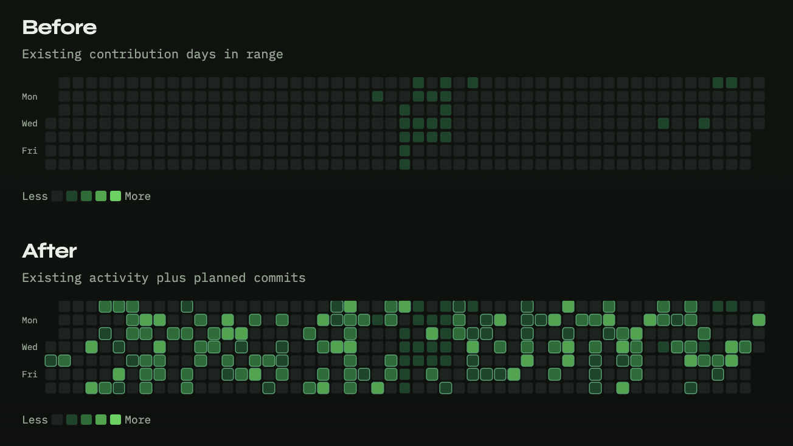

# gitlarp

Larp a realistic GitHub contribution activity on your profile into a dedicated private repo.

gitlarp plans backdated commits over a date range, skips days that already have activity, randomly skips other days for realism, and always shows a dry-run preview before pushing.



## Getting Started

### 1. Prerequisites

- Node.js 20+
- Empty **private** GitHub repo (default branch `main`)
- GitHub token with **`repo`** scope ([create one](https://github.com/settings/tokens))
- Verified email on your GitHub account (commits must use it)

### 2. Install and configure

```bash
npm install
npm install --prefix web
cp .env.example .env
```

Set `GITHUB_TOKEN` in `.env`.

### 3. Start the web UI

```bash
npm run web
```

Open [http://localhost:3000](http://localhost:3000). Paste your repo URL, set the date range and density, **Preview**, then **Push to GitHub** when it looks right.

The API runs on [http://localhost:8787](http://localhost:8787). Token stays in `.env` — never entered in the browser. Stop with `Ctrl+C`.

## Undo Commits

Delete the private activity repo on GitHub. After GitHub recalculates contributions (usually within a day), those commits disappear from your graph.

## CLI

Optional. Same options as the web UI:

```bash
npm run build
npm run dev -- --repo owner/name --from 2025-01-01 --to 2025-06-30 --push
```

## Notes

- Preview is the default. Public repos are blocked unless you opt in with `--allow-public`.
- Author email must match a verified GitHub email or squares won’t appear.
